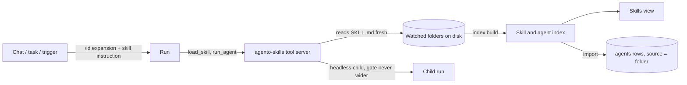

# PRD — In-app skills and agents

**Status:** Approved · **Date:** 2026-11-06 · **Slug:** `in-app-skills` · **Owner:** Masnun Siam · **Priority:** high · **Repo:** masnun-siam/agento

Status is `Draft`, `In review` or `Approved`. This document is the source of truth for the feature: every issue is derived from it, and a decision that is not written here has not been made.

## Overview

Agento learns to read skills and agents from folders on the user's machine and to use them in every run it starts: a chat, a scheduled task, a Telegram or Slack turn. A skill is a folder with a `SKILL.md`; an agent is a Markdown file with frontmatter. Both live in folders the user points Agento at, and Agento, not the Claude Code CLI, decides what a run sees. This is the foundation for porting the ai-workflow plugin (`~/Documents/Projects/Personal/ai-workflow`) into Agento one feature at a time; each later port (create-prd, the Inbox, dispatch, Away mode and the rest) gets its own PRD on top of this one.

Today:
- Agento has **agents** (name, model, thinking, permission mode, system prompt, and a tool allowlist over built-in tools, local tools and integration MCP tools), **chats** that run an agent interactively, **tasks** that run an agent on a schedule, and **Telegram and Slack** triggers that run one headless.
- Every run spawns the Claude Code CLI. Chats render the CLI's `AskUserQuestion` as an in-app question card and answer it by denying the tool with the user's text. Headless runs have nobody to answer.
- Agento hosts tools in-process over MCP (the `local-tools` server, and one server per enabled integration: GitHub, Slack, Jira, Confluence, Google, Telegram). That hosting path is the pattern this feature follows.
- Agento has no notion of a skill. Whatever skills the CLI finds on its own (a repo's `.claude/skills`, the CLI's `Skill` tool) are outside Agento's control.

## Problem

The user's workflow (PRD → tasks → refined issues → implement → review) lives in a Claude Code plugin: its skills, agents, guides and templates are installed into Claude Code and run through it. Agento cannot use any of it. No specific failure motivates cutting off the CLI's own skills (FR-14); the reason is to have one app-owned source of skills, so what a run can load is what the Skills view shows. The user wants the skills and agents to live in Agento, use Agento's own connections and question flow, and behave the same whichever run starts them.

## Users

One user, on their own machine: Agento is a single-user desktop app with no roles. Skills and agents are visible to every run on that install.

## Goals

- Point Agento at one or more local folders and see every skill and agent in them, with anything wrong flagged and explained.
- Start a skill in a chat by typing `/name`, and have the model load further skills by itself when a skill refers to them.
- Run a skill from a scheduled task without it hanging on a question.
- Let a skill start a folder-defined agent as a sub-run that is never fail-open unless the run that started it is.
- Have Agento's runs load skills only through Agento: the CLI's `Skill` tool is off in every run.

## Non-goals

- Porting any ai-workflow skill's content, or any ai-workflow UI feature (Inbox, Features board, Dispatch, Away mode, PRD Share, peer-review panel). Each is its own later PRD.
- Pausing a headless run until the user answers (the Inbox). Headless runs auto-answer in this version.
- An in-app editor for skills or agent files. Files are edited in the user's own editor; Agento only reads them.
- A live file watcher. Changes are picked up by the scan points in FR-3.
- Per-agent skill allowlists. Every agent sees every skill (Decisions).
- Limits on the number of folders or skills, or on skill size (Decisions).
- Running skill scripts (`scripts/*.sh`) on Agento's own; a skill's scripts run only if the model runs them with the tools the agent already has.
- Replacing the Claude Code CLI as the run engine, or a second harness.
- Nested sub-runs: an agent started by `run_agent` cannot start another.
- Copying or syncing skills into `~/.claude` or any other CLI configuration.

## Requirements

- **FR-1 Watched folders.** The user adds a local folder by absolute path (native picker) with a label, renames the label, and deletes the folder from the list. A label matches the agent slug rule (`^[a-z0-9]+(?:-[a-z0-9]+)*$`), is at most 40 characters and is unique. When no label is given, it is derived from the folder's base name: lowercased, every run of characters other than `a–z` and `0–9` replaced by one `-`, leading and trailing `-` removed, cut to 40 characters (and trailing `-` removed again); an empty result becomes `folder`; if the derived label is taken, `-2`, `-3`, … is appended until it is free. A label the user typed that is taken is refused with 409. A path must be an existing, readable directory, unique among watched folders, and must not contain or be contained in another watched folder. These paths, and any folder that contains one of them, are refused with 422 on `path`: the home directory, the filesystem root, Agento's data directory, the Claude Code CLI's config directory, and every per-agent config directory set on an agent. The refused-path and nesting checks compare paths with symlinks resolved, so a link to `~` is refused like `~`. Deleting a folder removes it from the list and removes the agents imported from it; nothing on disk is touched.
  - Acceptance: adding `~/Documents/Projects/Personal/ai-workflow` with no label lists it as `ai-workflow`; adding the same path again is refused with a conflict; adding a path that is a file or does not exist is refused naming the `path` field; adding two repos' `.claude/skills` folders with no label lists them as `skills` and `skills-2`; adding `~`, `/` or `~/.claude` is refused naming `path`; adding `ai-workflow/skills` while `ai-workflow` is watched is refused naming `path`; deleting it removes its skills and agents from the app and leaves every file in place.
- **FR-2 Folder layouts.** A watched folder is read in one of two layouts. **Plugin layout**: it has a `skills/` directory, an `agents/` directory, or both; each `skills/<name>/SKILL.md` is a skill and each `agents/*.md` is an agent. **Skills layout**: otherwise, each direct child directory containing a `SKILL.md` is a skill (and there are no agents). Directories and files whose names start with `.` are ignored. Every other file in a skill's directory, and every file in the watched folder outside `skills/` and `agents/` (for example `guides/`, `templates/`), is reachable by its path but is not itself a skill.
  - Acceptance: the checked-in fixture copy of the ai-workflow folder (Testing) yields 19 skills and 3 agents; a folder `~/skills` with `a/SKILL.md` and `b/notes.md` yields one skill, `a`.
- **FR-3 Index and rescan.** Agento builds the index of skills and agents at launch, when the Skills view is opened, and when the user presses Rescan. The launch build runs after the window is shown and never delays it. Folders are read in parallel, and reading one folder has a 10-second limit, after which that folder is flagged "Folder could not be read" and contributes nothing to that build; so a build finishes within about 10 seconds whatever the number of folders. A run that starts before the first build finishes waits for it, at most 10 seconds, and then starts with no skills if it still has not finished; a chat turn waiting on it shows "Loading skills…". A build that finds nothing changed writes nothing to the database. Loading a skill always reads its `SKILL.md` from disk at that moment, so an edit to a known skill takes effect on its next load without a rescan. A skill or agent added or removed on disk appears or disappears at the next index build.
  - Acceptance: editing a known `SKILL.md` and then loading it in a chat returns the new text with no rescan; a run started during the launch build gets the skill list once the build finishes; a folder whose read is held past the limit (a test hook lowers it) is flagged "Folder could not be read" and the others are indexed; two rescans with no file change leave the `agents` rows' update times untouched; adding a new skill folder shows it only after the view is reopened or Rescan is pressed.
- **FR-4 Skill metadata and validity.** A `SKILL.md` starts with YAML frontmatter. `name` and `description` are required; `name` is lowercase letters, digits and hyphens and must equal the skill's directory name. Optional fields: `argument-hint` (text), `connections` (a list of integration provider ids from Agento's integration catalog, e.g. `github`, `slack`, `jira`). Unknown frontmatter fields (for example `allowed-tools`) are ignored and listed as such. A skill whose frontmatter is missing, unparsable, or breaks a rule above is **invalid**: it is listed with its problems and is never offered to a run. There is no size or count limit.
  - Acceptance: a `SKILL.md` with no `description` is listed as invalid with "description is required" and `/that-skill` in a chat is not expanded; `connections: [github]` shows "Needs: GitHub" in the inspector.
- **FR-5 Skill ids.** A skill's id is `<folder label>:<name>`. In a chat message, a task prompt, and in `load_skill`, a bare `<name>` resolves to the skill when exactly one valid skill has that name. When several do, the name is **ambiguous**: it never resolves, and the message is "`/<name>` matches `<id>`, `<id>` — use the full id". A slash start with an ambiguous name spawns no CLI turn; the message is shown where FR-8 says. In `load_skill` it is the tool error.
  - Acceptance: with `ai-workflow` and `personal` both holding `pr-review`, sending `/pr-review` in a chat spawns no turn and the chat shows "`/pr-review` matches `ai-workflow:pr-review`, `personal:pr-review` — use the full id"; `/ai-workflow:pr-review` is expanded.
- **FR-6 Skills offered to every run.** Every run Agento starts (chat turn, scheduled task, Telegram and Slack triggers, `run_agent` child) is given the `agento-skills` tool server and a short instruction listing every valid skill's id and description, saying that `/<id>` or `/<name>` in any skill text means "load that skill with `load_skill`". Every agent sees every skill. `load_skill` is allowed without a prompt on every run, including a `read_only` task and a run whose mode is unchosen; it only reads files. The instruction lists skills sorted by id, so the same index always produces the same text.
  - Acceptance: a run of a new agent with no capabilities set is started with the skill server and a system prompt containing one line per valid skill in id order; a `read_only` task calling `load_skill` gets the skill's body, not a denial.
- **FR-7 `load_skill` tool.** `load_skill(name)` returns the skill's id, its folder's absolute path, its own directory's absolute path, the list of files under its directory (relative paths, recursive, skipping names that start with `.`; no cap, per the no-limits decision), and the `SKILL.md` body. An unknown or ambiguous name, or an invalid skill, returns a tool error naming the problem. Every watched folder is readable by every run without a prompt, so relative references such as `../../guides/engineering-workflow.md` can be read with the agent's file tools. The file-editing tools (Write, Edit, MultiEdit, NotebookEdit) are denied under a watched folder in every run, bypass included, **except** in a run whose working directory is inside, equal to, or contains that watched folder: that run edits it exactly as it edits its project today (the deny rules for that folder are omitted). This does not make the folder read-only: a run whose agent has `Bash` can still change files there.
  - Acceptance: in a chat, the model loading `ai-workflow:create-prd` can then read `ai-workflow/templates/prd.md` without a permission prompt for a path outside the project; an Edit or Write to that file from a chat whose working directory is elsewhere is denied, also in a bypass chat (Bash is out of scope); a chat whose working directory is the ai-workflow repo edits that file as today.
- **FR-8 Slash start.** A chat message or a task prompt whose first token is `/<id>` or `/<name>` that resolves (FR-5) starts the skill: the run receives the skill's body as the instruction for that turn, with the rest of the message as its arguments. The chat composer offers matching skills when `/` is typed at the start of a message, showing id, description and argument hint. A first token that names no skill is sent unchanged. A first token that is ambiguous (FR-5) or needs a missing connection (FR-9) spawns no CLI turn, and the message is shown: in a chat, as the turn's error result; in a task, as the run's `failed` `job_history` row. Telegram and Slack messages never slash-start a skill: their text is passed through unchanged, as today (Decisions); their runs still get the skill list and `load_skill` (FR-6).
  - Acceptance: sending `/create-prd add tags to chats` in a chat runs the create-prd instructions with `add tags to chats` as the arguments; sending `/nonexistent hi` sends the text unchanged; a task whose prompt is an ambiguous `/pr-review` records a `failed` run with the FR-5 message and spawns nothing.
- **FR-9 Required connections.** When a skill is started or loaded and the run's agent does not have at least one tool of each integration listed in `connections`, Agento does not run the skill: a slash start shows "`<skill>` needs `<Connection>` on agent `<agent>`" where FR-8 says (chat or task), and `load_skill` returns it as a tool error. A skill never adds tools to a run.
  - Acceptance: starting a `connections: [github]` skill on an agent with no GitHub tools shows the message and spawns no CLI turn; granting the agent one GitHub tool lets it start.
- **FR-10 Questions in chat.** A skill's questions in a chat use the existing in-app question card (the CLI's `AskUserQuestion`), unchanged.
  - Acceptance: `/create-prd` in a chat shows its interview questions as question cards and continues on the answers.
- **FR-11 Questions in headless runs.** In a **skill run** — a scheduled task whose prompt slash-started a skill, a scheduled task or Telegram or Slack trigger run that has called `load_skill` earlier in the run (triggers never slash-start, FR-8), and every `run_agent` child — an `AskUserQuestion` is answered at once: for each question, the option whose label ends with "(Recommended)", otherwise the first option; a multi-select question gets only that one option. The run continues. The answerer handles `AskUserQuestion` only: it changes neither the permission mode a headless run resolves to nor whether the run counts as fail-open, and every other permission prompt is handled exactly as today. When at least one question was auto-answered, the run's final output is followed by a blank line, the line `Auto-answered questions:`, and one line per question in the order asked, `- <question text> → <chosen label>`; nothing is appended when none was. The text is stored and delivered with the run (the task's `job_history` row, the trigger's reply under the trigger's existing length handling, the child's result). Every other headless run handles questions exactly as today.
  - Acceptance: a scheduled task starting `/create-prd` finishes without hanging, and its `job_history` output ends with the auto-answered list naming each "(Recommended)" choice; a task that never slash-starts or loads a skill and hits a question behaves exactly as today; a `full` task doing the same also gets the auto-answers (or, failing that, see Q7); the CLI arguments of a headless task, trigger and child differ from today's for the same agent and mode only by the run additions (Backend), so the permission mode and the fail-open verdict are unchanged; a `plan` trigger rule still runs.
- **FR-12 Imported agents.** An `agents/*.md` file is **valid** when it starts with YAML frontmatter holding `name` (matching the agent slug rule and equal to the file's base name) and `description`, both required; `tools` (a comma-separated string or a list) and `model` are optional; other fields are ignored and listed. A file that breaks these rules is listed as invalid with its problems and imports nothing. Each valid file in a plugin-layout folder becomes an Agento agent at each index build, with slug `<folder label>-<name>` (which then matches the slug rule by construction), name and description from frontmatter, the body as its system prompt, `model` copied as written (empty if absent), and its `tools` list mapped into built-in capabilities: each built-in tool name the CLI knows, with or without a `Bash(…)`-style pattern, is kept as written, and a kept `Tool(pattern)` entry counts as granting `Tool`, so `Tool` is not put on the run's denied list because of the agent's own tool list (the pattern still limits what is allowed without a prompt, and a task mode's own denials, such as `read_only` denying `Bash`, still apply); every other name (for example `Skill`, `Monitor`, `ScheduleWakeup`) is dropped and shown as a warning on the agent. An imported agent's permission mode is `default`. When the file changes the agent is updated at the next index build; when the file, or its folder, goes, the agent is deleted. A file whose slug would equal a user-made agent's slug is not imported and is listed as a conflict. When two files in different folders would get the same slug, neither is imported and both are listed as conflicts naming each other. A label rename whose new slugs would collide with an existing agent is refused with 409 naming the slug, and nothing changes. When an imported agent's `tools`, `model` or permission-relevant fields change at an index build, `changed_at` is set to that build's time, the Agents view and the Skills list mark it "Changed at <time>", and the app log records one line naming the agent and the old and new values. Imported agents cannot be edited or deleted through the app; the Agents view says "From `<folder label>` — edit `<path>`" beside the disabled controls.
  - Acceptance: after adding the fixture ai-workflow folder, the Agents view shows `ai-workflow-peer-reviewer` with all fourteen of its tools kept as written and no warning, a run of it can execute `git diff` without a prompt, an agent file listing `Skill` imports with a warning naming it, an agent file with no `description` is listed invalid, a file whose slug equals a user-made agent's is listed as a conflict, and `PUT /api/agents/ai-workflow-peer-reviewer` answers 409; editing a fixture agent's `tools` and rescanning sets `changed_at`, shows "Changed" and writes one log line with the old and new tools; after a label rename, a task bound to the old slug fails its next run with "agent not found" in `job_history`.
- **FR-13 `run_agent` tool.** `run_agent(agent, prompt)` runs the named agent (slug, or `<folder label>:<name>` for an imported one) once, headless, in the parent run's working directory, and returns its final message. The child uses its own agent's tools and model. Permission rule, by parent:

  | parent | `run_agent` |
  |---|---|
  | chat in mode bypass | any child |
  | other chat | child refused if it would run fail-open |
  | task with mode `full` | any child |
  | task with mode `read_only` | always refused: "a read_only task cannot start sub-runs" |
  | other task | child refused if it would run fail-open |
  | Telegram or Slack trigger run | always refused: "trigger runs cannot start sub-runs" |
  | `run_agent` child | always refused (depth 1) |

  "Fail-open" is the runner's existing verdict on the child's spec. A child that is not fail-open still keeps its own tool list, which may include tools the parent's agent lacks (Decisions); a prompt the child cannot answer headless is denied, as in any headless run. At most 4 children run at once per parent run, and at most 8 across the app; a call beyond either limit waits for a slot for at most 10 minutes, then returns "no sub-run slot free after 10 minutes". A parent turn may start at most 20 children in total; the 21st call returns "sub-run limit of 20 reached for this turn". A child runs for at most 30 minutes, or the parent task's remaining timeout if that is shorter; when the limit fires the child is stopped and the tool returns "`<agent>` timed out after <n> minutes". All children are cancelled when the parent turn ends or is stopped. Every child failure (unknown agent, refusal, the child's error `result`, a crash, the timeout, cancellation) comes back to the parent model as a tool error carrying the failure's text, and the child's chat ends with that error as a headless chat's failed run does today. Each child is recorded as its own chat, titled `<agent name> — from <parent>`, where `<parent>` is the parent chat's title or `task <task name>` (a trigger run cannot start children). A child's cost is on its own chat only; it is not added to the parent's chat or `job_history` row. Questions in a child follow FR-11.
  - Acceptance: from a chat whose mode is not bypass, `run_agent` on an agent whose mode is bypass returns a refusal and spawns nothing; from a `read_only` task and from a trigger run it returns the stated refusal and spawns nothing; from a `full` task a bypass child runs; four parallel `run_agent` calls run concurrently and a fifth starts when one finishes; with 8 children running app-wide, a ninth waits; stopping the parent chat ends every child; `run_agent` on an unknown slug returns a tool error naming it; a child that fails returns its error text; each child appears in Chats with its own cost and the title rule above.
- **FR-14 CLI `Skill` tool off.** Every run Agento starts (chat, task, trigger, `run_agent` child) has the CLI's `Skill` tool disallowed, so a run cannot load a skill through the CLI, including a repo's `.claude/skills`. Nothing else about how the CLI is started changes: setting sources, settings profiles (`--settings`), per-agent config directories, project settings, hooks and `CLAUDE.md` load exactly as today. A user who wants a repo's skills in Agento watches that folder.
  - Acceptance: for a chat, a task, a trigger and a child, with and without a settings profile and a per-agent config directory, the CLI arguments are today's arguments plus exactly the run additions (Backend), and nothing else differs; the run's `init` event lists no `Skill` tool.
- **FR-15 Skills view.** A new sidebar section, **Skills**, reachable also from a "Skills" entry in the command palette, with three panes:
  - **Folders**: All, then each folder with its skill count, plus *Add folder* and *Rescan*. Below the list, the total description length of valid skills ("Skill list: N characters sent with every run") and the line "Files in watched folders are sent to the model when a run loads them."
  - **List** of the selection: skills, then agents, under the headings "Skills" and "Agents"; an invalid entry carries the text badge "Invalid", an agent conflict "Conflict", a changed agent "Changed" (never colour alone).
  - **Inspector**. For a skill: id, folder, description, argument hint, required connections (each marked with whether that integration is connected in Agento; whether a given agent has its tools is FR-9's check, not shown here), problems, ignored fields, the files under the skill's directory, and the `SKILL.md` text. For an imported agent: slug, status, source path, model, tools, warnings and problems, and *Open in Agents* (a `NavTarget` to the agent). For a folder: path, label (editable, with Save/Revert) and *Delete*.
  - **Add folder**: the native picker returns a path; the folder pane then shows the path and a label field prefilled with the FR-1 default, with *Create* and *Discard*. While the request runs, *Create* is disabled with "Indexing…" beside it. A 422 or 409 is shown beside the field it names, here and on the label Save. On success the new folder is selected. *Rescan* is disabled with "Rescanning…" beside it while its request runs. After a confirmed delete, All is selected.
  - **Rename and delete name what breaks.** When tasks or trigger rules use the folder's imported agents, the label Save and the *Delete* confirmation say so: "Delete `<label>`? Its N skills and M imported agents leave Agento; K tasks and J trigger rules use these agents and will fail until changed; no files are deleted." (the K/J clause is omitted when both are 0); a rename shows "K tasks and J trigger rules use these agents and will fail until changed" beside Save.
  - A folder that no longer exists on disk is shown with "Folder not found", one that timed out with "Folder could not be read"; either contributes nothing.
  - Acceptance: with no folders, the view shows an empty state with *Add folder*; after adding ai-workflow and selecting `ai-workflow:create-prd`, the inspector shows its frontmatter fields and body; selecting `ai-workflow-peer-reviewer` shows its tools and *Open in Agents*; renaming a folder's label changes every skill id and imported agent slug at once; deleting a folder used by a task names that task count in the confirmation.

## Edge cases

- **Concurrency.** Index builds are serialised: a build requested while one runs waits for it and then runs, and `GET /api/skills` and the rescan answer with the newest finished build, whose `built_at` says which it is; and imported-agent writes are one transaction per build so a reader never sees half an import. A chat turn holding a loaded skill keeps working if the skill's file is deleted mid-turn; the next `load_skill` reports it missing. Renaming a folder label while a run is using its skills does not affect that run's already-loaded text; new loads use the new ids.
- **Imported agent in use.** Deleting a folder or file whose agent is used by a task or a chat: the agent row is deleted as a user-made agent's deletion would be, and the task's next run fails with "agent not found" in `job_history`, as it does today for a deleted agent. Existing chats keep their history.
- **Empty states.** No folders: the Skills view shows *Add folder*, runs get no skill instruction and no `agento-skills` tools. A folder with nothing valid: listed with a count of 0 and its invalid entries.
- **Missing folder.** A watched folder deleted or unmounted: kept in the list, flagged "Folder not found", its skills not offered, its imported agents deleted at the next index build and re-created when it returns.
- **Limits.** None on folders, skills or file size (Decisions). A very large folder makes every run's skill instruction longer; the Skills view shows the total description length so the cost is visible.
- **Symlinks.** A symlinked skill directory, `SKILL.md` or agent file is followed only when its resolved path stays inside the watched folder; one that resolves outside it, and a symlink loop, is skipped and listed as a problem. No file outside a watched folder is ever read by the indexer, the skill routes or `load_skill`.
- **Label changes.** A label rename changes skill ids and imported agent slugs. A task or trigger that names an imported agent by its old slug fails at its next run with "agent not found"; the rename names how many do before it is saved (FR-15). A chat's history is unaffected.
- **Data isolation.** Single-user desktop app: no tenants. Skill content never leaves the machine except as part of a run's prompt to the model the agent is configured for. Agento itself reads file contents only from inside watched folders (Symlinks). Runs gain read-only access to watched folders (FR-7), and FR-1 refuses the home directory, the root, the data directory and the CLI config directory as watched folders, so no run gains them.
- **Existing data.** No migration of existing rows. Existing agents gain no fields on the wire unless imported (Data). Existing chats, tasks and triggers behave the same except that the CLI's `Skill` tool is unavailable to them (FR-14), so a run that relied on a repo's `.claude/skills` through it no longer can. Existing headless runs that are not skill runs answer questions as today (FR-11). Once a folder is watched, runs whose working directory does not overlap it can no longer edit files in it with the file-editing tools (FR-7); runs in that folder's own project edit it as today.

## Technical design


*How the parts relate: folders feed an index, the index feeds the view and the imported agents, and every run reaches skills only through Agento's own tool server.*

### Data

SQLite, through the existing migration path. (FR-1, FR-12)

`skill_folders`:

| column | type | rule |
|---|---|---|
| `id` | INTEGER PRIMARY KEY | |
| `path` | TEXT NOT NULL UNIQUE | absolute, cleaned |
| `label` | TEXT NOT NULL UNIQUE | `^[a-z0-9]+(?:-[a-z0-9]+)*$`, at most 40 characters (FR-1) |
| `created_at` | TEXT NOT NULL | RFC 3339 |

`agents` gains three nullable columns:

| column | type | rule |
|---|---|---|
| `source_folder_id` | INTEGER NULL REFERENCES `skill_folders(id)` ON DELETE CASCADE | NULL for a user-made agent |
| `source_path` | TEXT NULL | absolute path of the agent file |
| `import_warnings` | TEXT NULL | JSON array of strings |

The skill index itself is not stored: it is rebuilt in memory at each index build (FR-3) and `SKILL.md` bodies are read on demand. No backfill; every existing agent has NULL sources.

### API

All routes follow the `/api` contract: bearer token, `Content-Type: application/json` on writes, `read` scope for GETs and `write` for the rest, validation 422 naming the field, conflicts 409, unknown ids 404, every array field may be `null`.

**`GET /api/skill-folders`** → `200 [Folder]`, ordered by label. (FR-1, FR-15)

```
Folder {
  id: number, path: string, label: string, created_at: string,
  exists: boolean,            // false → "Folder not found"
  problems: [string] | null,  // e.g. "Folder could not be read"
  layout: "plugin" | "skills",
  skill_count: number,        // valid skills
  agent_count: number,        // imported agents
  invalid_count: number
}
```

**`POST /api/skill-folders`** `{ path: string, label?: string }` → `201 Folder`, after an index build of that folder. 422 on `path` (not absolute, not a directory, not readable, a refused path, or nested in or containing a watched folder) or `label` (shape); 409 on a duplicate `path` or a typed `label` that is taken.

**`PUT /api/skill-folders/{id}`** `{ label: string }` → `200 Folder`; re-slugs that folder's imported agents in the same transaction. 422/409 as above, 409 when a new slug collides with an existing agent, 404 unknown id.

**`DELETE /api/skill-folders/{id}`** → `204`; its imported agents are deleted by the cascade. 404 unknown id.

**`POST /api/skills/rescan`** (no body) → `200 SkillIndex` of the build it started, after waiting for any build already running. A folder that cannot be read never fails the route: it is reported in that folder's `problems`. (FR-3)

**`GET /api/skills`** → `200 SkillIndex`, from the last index build (building one if none exists yet). (FR-4, FR-15)

```
SkillIndex {
  skills: [Skill],
  agents: [ImportedAgent],
  built_at: string,
  description_chars: number   // total length of valid skills' descriptions
}
Skill {
  id: string,                 // "<label>:<name>"
  folder_id: number, name: string, description: string,
  argument_hint: string, connections: [string] | null,
  dir: string,                // absolute path of the skill's directory
  valid: boolean, problems: [string] | null,
  ignored_fields: [string] | null
}
ImportedAgent {
  slug: string, folder_id: number, source_path: string,
  status: "imported" | "invalid" | "conflict",
  changed_at: string | null,  // last index build that changed tools, model or mode
  problems: [string] | null, warnings: [string] | null
}
```

**`GET /api/skills/{label}/{name}`** → `200 Skill & { content: string, files: [string] }`, `content` read from disk now, `files` relative to the skill's directory (FR-7). `{label}/{name}` is looked up in the index and never joined onto a path; anything that is not an indexed skill (including a name with `..` or a separator) answers 404 without touching the disk.

**Agents.** `GET /api/agents` and `GET /api/agents/{slug}` add `source: { folder_id, folder_label, path, warnings, changed_at }` to an imported agent only; the key is omitted for a user-made agent, so their bytes are unchanged. `PUT` and `DELETE` on an imported agent answer **409** `agent <slug> is managed by folder <label>; edit <path>`. `POST` with a slug an imported agent holds answers 409 as any duplicate does.

**Chat, tasks, triggers.** No new fields. Slash expansion (FR-8) and the connection check (FR-9) happen on the server when the turn or run starts; an ambiguous name or failed connection check on a chat turn answers the turn with a single `result` event with `is_error: true` and the FR-5 or FR-9 message, and spawns nothing.

### Backend

- **Indexer** (FR-2 to FR-5, FR-12). Walks every watched folder, parses frontmatter with the YAML parser already in the app, validates, and produces the index. Imported agents are written in one transaction per build: insert new, update changed, delete gone, keyed by `source_path`. Runs on a blocking thread; the database rules (open through `native::db`, nothing on a tokio worker touches SQLite) apply. Concurrent builds are serialised; a build never fails as a whole because of one bad file; a build with no change writes nothing; each folder read is bounded by FR-3's 10-second limit.
- **`agento-skills` tool server** (FR-6, FR-7, FR-9, FR-13). One more in-process MCP server, hosted the one way the repo hosts tools, started per run, granted and pre-allowed on every run regardless of the agent's capabilities or mode (FR-6). Tools: `load_skill { name: string }` and `run_agent { agent: string, prompt: string }`. In a `run_agent` child the server offers `load_skill` only.
- **Skill instruction** (FR-6). Appended to every run's system prompt: the rule for `/<id>` references and one line per valid skill, `<id> — <description>`, sorted by id. Absent when there are no valid skills.
- **Readable directories** (FR-7). Every watched folder that exists is added to each run's additional directories, and every run carries deny rules for Write, Edit, MultiEdit and NotebookEdit under each of them except a folder inside, equal to, or containing the run's working directory (FR-7), so a loaded skill's guides and templates are readable without a prompt and not editable through those tools.
- **Slash expansion** (FR-8, FR-9). A shared step used by the chat turn and by the runner: resolve the first token, check connections against the run's agent, and replace the message with the skill's body followed by `ARGUMENTS: <rest of message>`. The stored user message in the chat stays what the user typed.
- **Headless question answering** (FR-11). Headless runs answer `AskUserQuestion` the same way the chat does (deny with text), with the FR-11 choice, and keep the list of auto-answers on the run's result; the result's stored and delivered text gets the FR-11 section appended. Today the presence of a permission handler is what the runner reads as "interactive", which picks the mode and the fail-open flags; the answerer must not change that input, so the resolved mode, the CLI arguments and the fail-open verdict of every headless run stay what they are today, and every other prompt is denied as today.
- **`run_agent`** (FR-13). Starts a headless run through the existing runner seam with the child agent's spec and the parent's working directory, under the FR-13 permission rule. A refusal is returned to the model as the tool's error. FR-13's slot, total and time limits; children are tied to the parent turn's cancellation and killed with it. The run's MCP tool timeout is raised (Run additions) so the CLI never abandons a `run_agent` call first. Each child writes its own chat row as headless runs do.
- **Run additions.** The complete list of what this feature adds to a run's CLI arguments and environment; everything else is today's: the `agento-skills` MCP server and its allow rule (FR-6); the skill instruction appended to the system prompt (FR-6); each existing watched folder as an additional directory, with deny rules for the file-editing tools under it, unless it overlaps the run's working directory (FR-7); `Skill` on the disallowed list (FR-14); the MCP tool timeout raised above FR-13's child limit plus slot wait. The timeout is run-wide in the CLI, so it also applies to every other MCP tool of the run (integrations and `mcps.yaml` servers), which can then run up to that long before the CLI abandons them.
- **`Skill` tool off** (FR-14). `Skill` is added to every run's disallowed tools; setting sources, `--settings` and config directories are untouched.

```mermaid
sequenceDiagram
    participant U as User
    participant C as Chat turn
    participant S as agento-skills
    participant M as Model (CLI)
    participant K as Child run
    U->>C: /ai-workflow:peer-review docs/prds/x.md
    C->>C: resolve id, check connections, expand body
    C->>M: turn with skill body + skill list
    M->>S: run_agent(ai-workflow-peer-reviewer, lens prompt)
    S->>S: gate = min(child, parent); slot (max 4)
    S->>K: headless run
    K-->>S: final message (+ auto-answered questions)
    S-->>M: result
    M-->>C: AskUserQuestion
    C-->>U: question card
```
*A slash start that spawns a sub-run and then asks the user a question.*

### Frontend

- **Skills view** (FR-15), a new sidebar section with its own per-view stylesheet, three resizable panes, the standard empty, loading and error states, folder add through the native directory picker (`/api/fs` fallback in a plain browser), label editing through the shared save bar, inline delete confirmation, and *Rescan*. Disabled controls state their reason in visible text.
- **Chat composer** (FR-8): a `/` at the start of the message opens a filtered list of valid skills (id, description, argument hint) from `GET /api/skills`. While the list is open, Up/Down move the highlight, Enter and Tab insert the highlighted `/<id> ` (Enter does not send), Esc closes the list and keeps the text; with the list closed, Enter sends as today. Rows: "Loading skills…" while the request runs, "Could not load skills" on failure, "No skill matches `/<text>`" when the filter is empty, "No skills — add a folder in Skills" when there are none. The list is a listbox of options with the highlighted one active for screen readers. The FR-5 and FR-9 messages arrive as the turn's error result.
- **`run_agent` in a chat**: the tool call row shows the child agent's name, "Waiting for a slot", "Running", "Done" or "Failed: <text>", and once started a link to the child's chat (a `NavTarget`).
- **Agents view** (FR-12): imported agents show "From `<label>` — edit `<path>`", their warnings, "Changed at <time>" when set, and disabled edit and delete controls with that reason beside them.
- **Command palette** (FR-15): a "Skills" entry navigating to the view.

### Realtime and other services

Not affected. No events are broadcast; the Skills view and the composer read on open. The LLM gateway, insights, scanner and credentials checker are unchanged; a skill's run is costed like any other run.

### Non-functional

- **Security.** Skills never widen an agent's tools (FR-9); `run_agent` never widens permission (FR-13); imported agents are created at permission mode `default`, never bypass. The skill files are read only from inside watched folders, under which runs' file-editing tools are denied (FR-7; Bash is not covered). A watched folder is trusted by the user's act of adding it, and the Skills view states that its files are sent to the model.
- **Performance.** An index build of the ai-workflow folder completes in under 1 second on a laptop; `load_skill` reads one file. No limits are applied (Decisions); the skill instruction grows with the number of skills and is stable for an unchanged index, so it does not defeat prompt caching. Launch is never delayed by an index build (FR-3).
- **Compatibility.** macOS, Linux and Windows paths, through the app's existing path helpers. Existing agents' JSON is byte-identical.

### Testing

- Indexer and validation (FR-1 to FR-5, FR-12): unit tests over checked-in fixture folders in both layouts, including invalid, ambiguous, conflicting, nested, derived-label and symlinked (inside and outside) entries. The ai-workflow counts and tool mapping are asserted against a checked-in copy of that folder's `skills/*/SKILL.md` and `agents/*.md`, taken at a recorded commit, never against the live folder; the live folder is a manual smoke check only.
- API (FR-1, FR-3, FR-15 data, imported-agent 409s): route tests for every status listed above; a golden of an unchanged user-made agent's JSON.
- Time limits (FR-3's 10 seconds, FR-13's slot wait and child limit) are set through a test hook, so their tests run in seconds.
- Tool server (FR-6, FR-7, FR-9, FR-13): tests through the in-process MCP server with the scripted fake CLI, including the permission refusal for each parent kind, the 4-slot limit, the slot wait, the total cap, the child timeout, every child failure path, and cancellation on turn end; `load_skill` allowed on a `read_only` task.
- Slash expansion and headless answers (FR-8, FR-11): runner tests with the fake CLI emitting an `AskUserQuestion`, asserting the chosen labels and the exact appended section in `job_history` (and its absence with no questions), and that the argv of headless task, trigger and child runs differs from today's only by the run additions, for every mode.
- `Skill` off (FR-14): argument-builder tests for each run kind, with and without a profile and config directory, asserting the only differences from today are FR-7's and FR-14's; a manual check in a repo with `.claude/skills`.
- Frontend (FR-15, composer, agents view): component tests for empty, invalid and imported states; a manual pass of adding the ai-workflow folder and running `/ai-workflow:create-prd` in a chat.

## Rollout and cost

Ships to everyone in the next release, with no setting to gate it: a user with no watched folders sees an empty Skills view and runs that behave as today, except that the CLI's `Skill` tool is off in every run (FR-14), which ends repo `.claude/skills` use through the CLI for every install. The release notes say so and tell users to watch such a folder in Agento instead. No billing impact beyond the extra prompt text of the skill instruction and any `run_agent` child runs, both costed as normal runs. Nothing for operations to do.

## Success metrics

No metric: a single-user tool whose value is that the ported workflow runs at all, which the acceptance criteria already test. Working check: the ai-workflow folder imports with 19 valid skills and 3 agents, and `/ai-workflow:create-prd` runs an interview in an Agento chat end to end.

## Epics

- **E1 In-app skills and agents** — covers FR-1 to FR-15. Issue: #1

## Decisions

- **Foundation only in this PRD; each ai-workflow feature is ported in its own PRD** — the user ports one by one, and a whole-port PRD would go stale before its later epics start.
- **The Claude Code CLI stays the run engine; skills and agents live only in Agento** — "no dependency on Claude/Codex" means Agento owns what a run sees, not that it replaces the engine; replacing it would rebuild tools, permissions and compaction. Any provider stays reachable through the gateway.
- **Skills come from watched local folders, several of them; no in-app editor** — the user's choice; the files stay in the user's editor and repos.
- **Start a skill by `/slash` in chat, by the model loading it, and from scheduled tasks** — the user chose all three.
- **Skills reach the model through an Agento-hosted tool server, not the CLI's plugin loading** — harness-neutral, and follows the repo's single way of hosting a tool.
- **Agent files are imported as Agento agents and a skill can start one through `run_agent`** — the user wants ai-workflow's agents runnable now.
- **A skill declares connections; the agent grants them; a skill never adds tools** — any file in a watched folder could otherwise widen what a run may do.
- **Headless questions take the recommended (else first) option and are listed in the output** — runs never hang; the Inbox that holds them is a later PRD.
- **Skill ids are `<folder label>:<name>`, bare names when unique** — matches how the user already invokes these skills and keeps cross-skill references readable.
- **Imported agents are folder-managed and read-only in the app** — the file stays the source of truth, as for skills, with no drift.
- **`run_agent` children are depth 1, cancelled with the parent, costed on their own chat** — #693's gate stays the boundary.
- **A new Skills view in the sidebar** — the three-pane convention, and a place to see why a skill is flagged.
- **Every agent sees every skill; no per-agent allowlist** — the user's choice; zero configuration.
- **No live watcher: index at launch, on view open and on Rescan; `SKILL.md` read fresh on every load** — no new dependency, and edits to known skills apply at once.
- **Only the CLI's `Skill` tool is turned off; setting sources, profiles, config directories and project settings are untouched** — one app-owned source of skills without taking project permissions, hooks or `CLAUDE.md` away from any run. No specific failure motivated it; the reason is one source.
- **Headless auto-answering applies only to skill runs and `run_agent` children** — existing tasks and triggers keep today's behaviour for questions.
- **`run_agent`: a child is refused if it would run fail-open and the parent is not; `read_only` tasks and trigger runs cannot start children; a child keeps its own tools** — the user's choice; agents on one install are the user's own, and the fail-open line is the one the runner already enforces.
- **Telegram and Slack messages do not slash-start skills in this PRD** — sender text is untrusted, Slack intercepts a leading `/`, and Telegram commands cannot contain `:` or `-`.
- **At most 8 `run_agent` children at once across the app, 4 per parent** — bounds CLI processes when the scheduler runs several tasks at once.
- **File-editing tools are denied under watched folders except in runs whose working directory overlaps the folder** — the user's choice; keeps a watched repo editable from its own chats and tasks (ai-workflow's `skill-feedback`), while other runs cannot edit skill files through those tools.
- **A changed imported agent is marked "Changed" and logged, not held for re-approval** — single user, files in the user's own repos.
- **Unknown agent tools are dropped with a warning; the agent still imports; `model` is copied as written** — one odd tool should not hide an agent.
- **No limits on folders, skills or sizes** — the user's choice; the Skills view shows the total description length so the cost stays visible.
- **Priority high, one epic** — everything else ported depends on it, and its parts are only useful together.
- **Q7: if the CLI does not route `AskUserQuestion` to the answerer under `bypassPermissions` (a `full` task, a `bypass` rule), those runs keep today's behaviour for questions, FR-11's acceptance for a `full` task is dropped, and Goal 3 is amended to name the task modes it covers** — both outcomes are acceptable, so it does not block approval; the first FR-11 issue's test settles which applies and amends this PRD through the Change log.

## Open questions

None. Q1 to Q6 of round 1 were answered by the user and Q7 was settled at approval; all are recorded in Decisions.

## Change log

- 2026-11-06 — Approved after the peer-review panel (all seven lenses approve; their changes were applied in place during review). Q7 moved from Open questions to Decisions as a settled contingency. Epic filed as #1.

## Related

- Source plugin: `~/Documents/Projects/Personal/ai-workflow` (`skills/`, `agents/`, `guides/`, `templates/`, `CONTEXT.md`).
- Agento: `docs/internal/native-chat.md` (the chat turn and `AskUserQuestion`), `docs/internal/native-runner.md` (the runner seam and permission gate, #693, #694), `docs/internal/claude-sdk.md` (hosting a tool, #282), `docs/internal/native-integrations.md`, `docs/internal/frontend.md`.
